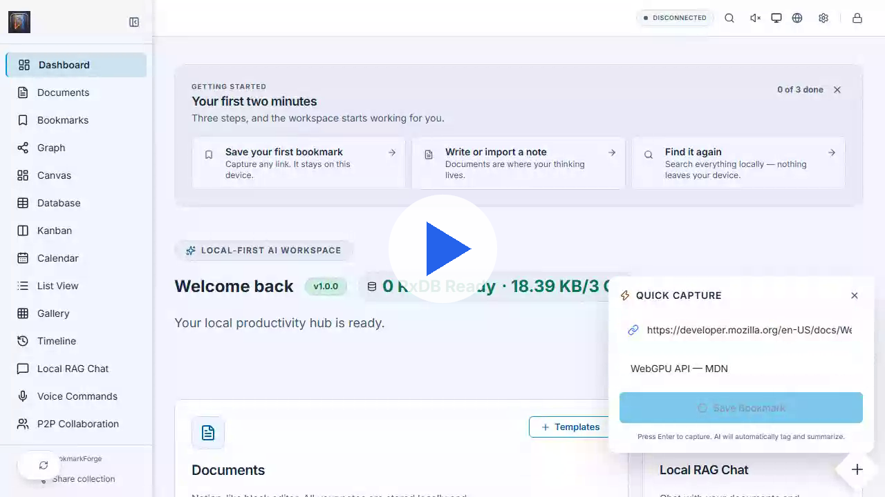
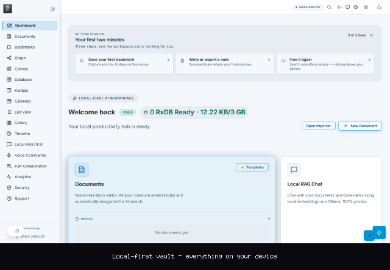
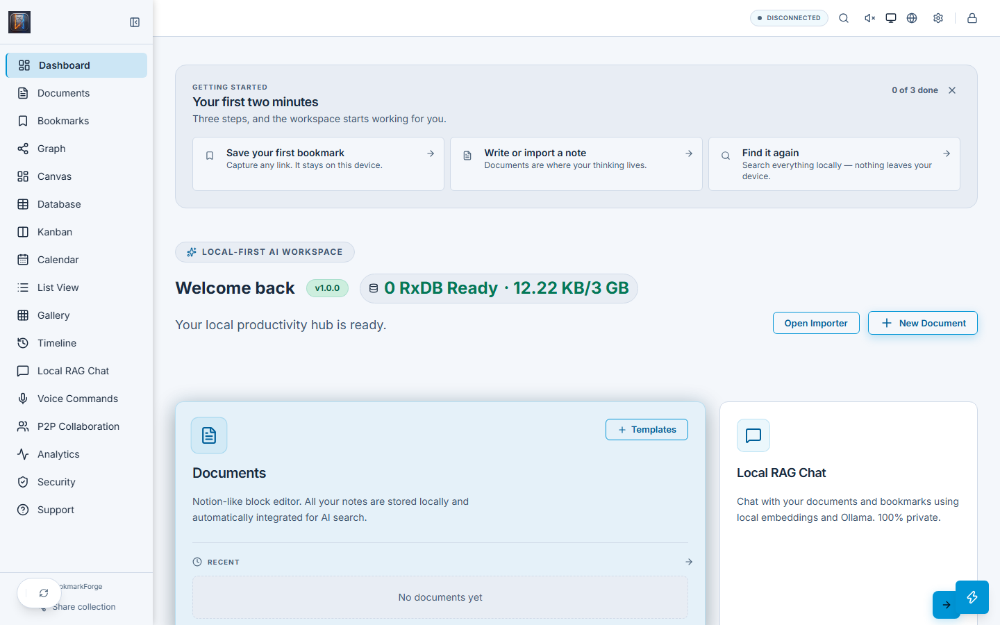

# BookmarkForge

> Modelo de distribución: **Open Core**. El Core público se licencia bajo MIT;
> las funciones Pro identificadas en `OPEN-CORE.md` son propietarias y no están
> cubiertas por esa licencia.

Aplicación local-first de conocimiento personal: almacenamiento cifrado, funcionamiento
offline, sincronización P2P opcional y funciones de IA que llaman **directamente** al
proveedor que el usuario configura.

## Estado del proyecto

<!-- Estado 2026-09-19: `bookmarkforge/core` es el destino confirmado —el remoto,
     package.json, los badges y las RELEASE-NOTES del export coinciden—, pero aún
     no hay evidencia de PRs o ejecuciones de CI verificadas en GitHub. Antes de
     publicar, ejecutar los workflows contra el repositorio remoto; ver
     docs/github-secrets-and-push-runbook.md y docs/audit.md. -->

> **Nota**: Los badges apuntan al destino confirmado `bookmarkforge/core`; el gate
> `check:release-target` sale 0 mientras las cuatro superficies coincidan.
> Ejecutar `npm run check:ci` localmente para verificar que todo pase antes de push.

[](https://github.com/bookmarkforge/core/actions/workflows/ci.yml) · [](https://github.com/bookmarkforge/core/actions/workflows/nightly.yml) · [runs fallidos](https://github.com/bookmarkforge/core/actions/workflows/nightly.yml?query=conclusion%3Afailure) · [último release](https://github.com/bookmarkforge/core/releases/latest) · [operación del nightly](docs/ops-nightly.md)

## Demo visual

> La demo principal muestra la aplicación real: bóveda local, captura de un bookmark y flujo de trabajo privado. La landing se conserva como material de marketing separado. La evidencia completa de release está en el [paquete de Release Candidate](docs/release-candidate-package-2026-09-21.md).

### Recorrido en vídeo

[](docs/bookmarkforge-demo-tour.webm)

Vídeo WebM de 47 s y 1,0 MB en 1280×720, grabado con la aplicación real y datos
de demostración. GitHub no reproduce dentro del README un vídeo alojado en el
propio repositorio, así que el póster enlaza al archivo; para reproducción en
línea puedes adjuntar el `.webm` en un comentario y usar la URL resultante. Los
detalles del flujo, la verificación y los presupuestos están en
[docs/demo-media.md](docs/demo-media.md).

### Resumen en bucle (GIF)



<picture>
  <source media="(max-width: 700px)" srcset="docs/bookmarkforge-demo-app-mobile.png">
  
</picture>

[Ver hero de la landing](docs/bookmarkforge-demo-landing-hero.png)

## Requisitos

- Node.js `>=20.19.0`
- npm
- Docker Compose para los entornos containerizados

## Desarrollo local

```bash
npm ci
cp .env.example .env
npm run typecheck
npm run lint
npm run test:fast
npm run dev
```

El frontend se ejecuta con Vite en modo PWA. El servidor acompañante se inicia con
`npm run server` y expone **señalización WebSocket P2P**, `/health`, los endpoints de
licencia (`/api/license/*`), informes CSP, telemetría opt-in de cliente y analítica
agregada opt-in. El servidor no recibe contenido del vault.

### Proveedores de IA

No hay proxy de IA en el servidor. Cada llamada sale del navegador directamente al
proveedor elegido, con una clave que el usuario guarda cifrada en su propio vault
(`securityVault`) desde Ajustes:

- En la nube: Gemini, OpenAI, Anthropic, Groq, Hugging Face, OpenRouter.
- Locales: Ollama y modelos en el navegador con WebLLM.

Consecuencia de seguridad: la clave del usuario nunca pasa por nuestros servidores, y el
servidor no necesita (ni acepta) ninguna credencial de IA. Las llamadas cloud
se realizan directamente desde el navegador con la clave del usuario.

## Verificación antes de fusionar

```bash
npm run typecheck:prod
npm run lint
npm run test:fast
npm run build:ci
npm run check
```

No se deben introducir secretos reales en el repositorio. Usa un gestor de secretos o
variables de entorno fuera del control de versiones. `scripts/check-secrets-in-commit.mjs`
se ejecuta como gate de CI.

## Arquitectura

```text
Browser / PWA / Extension
          |
          | HTTPS/WSS
          v
Reverse proxy (TLS, CSP, static assets)
          |
          +--> Web frontend (React/Vite)  ---> Proveedores de IA del usuario (BYO key)
          |
          +--> Companion server (Node/ws)
                  +--> señalización WebSocket P2P
                  +--> licencias y entitlement (Ed25519/RSA-PSS)
                  +--> health, informes CSP, telemetría opt-in

Cliente: React + TypeScript + RxDB/IndexedDB + Web Workers + WebRTC
Criptografía: AES-GCM, Argon2id/HKDF, claves gestionadas en workers
```

El cliente es la fuente principal de los datos del vault. Los dos servicios de la
topología de producción son **stateless**: no hay base de datos ni Redis compartido.

## Producción

La topología está en `docker-compose.prod.yml` (servicios `web` y `api`). Requiere
configurar secretos y endpoints mediante el entorno de despliegue. El despliegue debe usar
imágenes identificadas por SHA, ejecutar todos los gates y conservar un procedimiento
probado de rollback.

```bash
npm run check:env
npm run check:secrets-in-commit
npm run check:marketing
npm run build:ci
npm run production-smoke
```

No ejecutes scripts de despliegue contra producción sin aprobación operativa explícita.

## Seguridad y privacidad

- TLS debe terminar en el reverse proxy con redirección HTTPS y HSTS.
- Configura `AI_SESSION_ORIGINS` con los orígenes exactos del navegador. Es la allow-list
  de `POST /api/license/entitlement` y una variable **obligatoria** en producción: sin ella
  el compose de producción no arranca. El nombre es histórico (el endpoint responde el
  *plan* de licencia, no una sesión de IA).
- La clave pública de licencias vive en dos copias (`src/services/licenseKeys.ts` y
  `server/src/license-public-key.ts`). `node scripts/generate-license-keys.mjs
  --sync-server-key` las alinea y `npm run check:license-keys` falla si divergen.
- Mantén `ENFORCE_SIGNAL_HMAC=1` en producción.
- No expongas puertos de servicios internos al host; los compose publican en loopback.
- No registres contraseñas, claves, prompts ni contenido del vault.
- Los backups automáticos son cifrados; la restauración debe probarse periódicamente.

El cifrado y las medidas técnicas no constituyen por sí solos una declaración de
cumplimiento RGPD. El responsable debe mantener inventario de tratamientos, retención,
derechos, proveedores y base jurídica.

## Operación mínima

- `/health` es un endpoint de liveness sin datos sensibles.
- Configura `SIGNALING_ADMIN_TOKEN` y `CSP_REPORT_ADMIN_TOKEN` únicamente en el gestor de secretos.
- Revisa eventos estructurados, errores críticos, saturación, conexiones, latencia y
  disponibilidad.
- Define y registra RPO/RTO antes del lanzamiento público.
- Ejecuta un restore de backup al menos mensualmente y un simulacro de desastre trimestral.

## Licencias y modelo Open Core

- [Modelo Open Core](OPEN-CORE.md)
- [Licencia MIT del Core](LICENSE)
- [Licencia propietaria Pro](PRO-LICENSE.md)
- [Política de marca](scripts/public-export/TRADEMARKS.md)

El checkout privado contiene el Core y componentes Pro. Para obtener el repositorio
público reproducible usa `node scripts/export-public-repo.mjs`; no publiques el checkout
completo como si todo estuviera bajo MIT.

## Documentación

- [Índice de documentación](docs/index.md)
- [Arquitectura](docs/architecture.md)
- [Seguridad](docs/security.md)
- [Operaciones](docs/operations.md)
- [API del servidor acompañante](docs/api.md)
- [Especificación OpenAPI](docs/openapi.yaml)
- [Auditoría](docs/audit.md)
- [ROPA (RGPD)](docs/ROPA.md)
- [Checklist de lanzamiento](docs/launch-checklist.md)
- [Posicionamiento comercial](docs/positioning.md)
- [Plan de validación comercial de 30 días](docs/market-validation-plan.md)
- [Self-hosting](docs/SELF-HOSTING.md)
- [Convenciones de ingeniería](AGENTS.md)
- [Onboarding de contribuyentes](docs/ONBOARDING.md)

### Manuales de usuario

Cada idioma tiene versión Markdown (fuente) y PDF generado desde el mismo contenido.

| Idioma | Markdown | PDF |
|---|---|---|
| Español | [manual-usuario.md](docs/manual-usuario.md) | [manual-usuario.pdf](docs/manual-usuario.pdf) |
| English | [manual-usuario-en.md](docs/manual-usuario-en.md) | [manual-usuario-en.pdf](docs/manual-usuario-en.pdf) |

Las otras 28 locales viven en `docs/manual-usuario-<código>.md` (+ `.pdf`) y están
listadas en [docs/index.md](docs/index.md). Los intermedios `*-styled.html` se generan
con `npm run docs:pdf:localized` y no se versionan.

### Scripts y herramientas

168 scripts de build, verificación y operaciones en `scripts/README.md`.
Los checks se organizan en 8 grupos para iterar más rápido:

| Grupo | Tiempo | Uso |
|---|---|---|
| `core-integrity` | ~3s | `npm run check:core-integrity` |
| `security-environment` | ~4s | `npm run check:security-environment` |
| `quality-code` | ~25s | `npm run check:quality-code` |
| `content-integrity` | ~12s | `npm run check:content-integrity` |
| `brand-visual` | ~5s | `npm run check:brand-visual` |
| `security-depth` | ~8s | `npm run check:security-depth` |
| `build-verification` | ~60s | `npm run check:build-verification` |
| `workflow-pipeline` | ~5s | `npm run check:workflow-pipeline` |

Para iterar rápido: `npm run ci:fast` (~7s) o `npm run check:ci-groups --fast`.
Ver `scripts/README.md` para el catálogo completo de herramientas.

---

*BookmarkForge v1.0.0 — Open Core: MIT Core + Pro propietario.*
